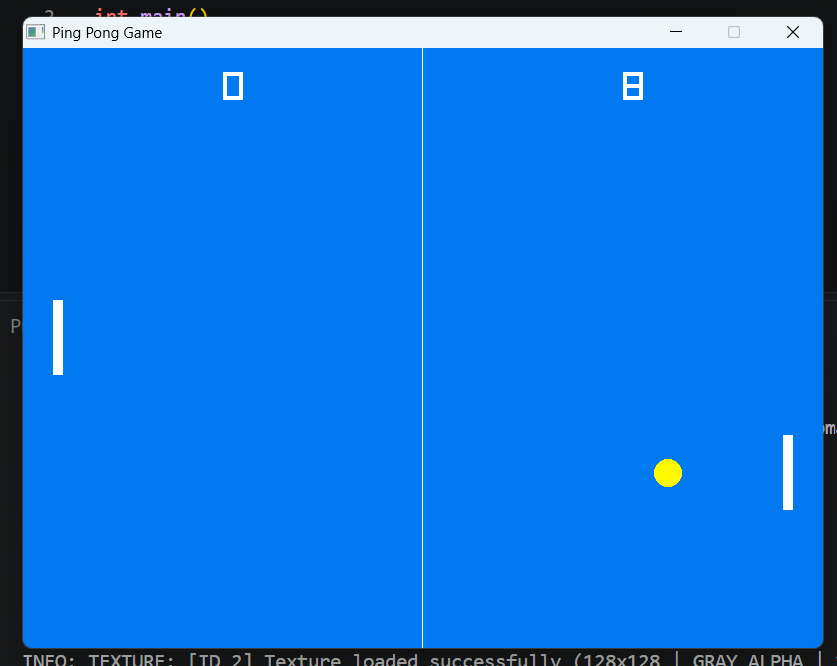

# Pong in C++ & Raylib

A minimalist 2D Pong game written in C++ using Raylib. I built this from scratch to get hands-on experience with game loops, 2D vector kinematics, collision mathematics, and basic tracking AI without relying on high-level game engines.



## Overview

Instead of using a pre-packaged physics engine, all movement, boundaries, and collisions are calculated manually:

- **Game Loop:** Runs at a locked 60 FPS using Raylib's frame limiter.
- **Physics & Motion:** Ball translation is handled via 2D velocity vectors ($x_{t+1} = x_t + v_x$).
- **Collision Detection:** Paddle hits use circle-to-box (AABB) intersection tests (`CheckCollisionCircleRec`).
- **AI Opponent:** A heuristic AI tracks the vertical center of the ball and adjusts its paddle position with a balanced speed cap.
- **Score & Resets:** Detects out-of-bounds goals, updates the scoreboards, and respawns the ball at the center.

### Engineering Highlight: Fixing the "Sticky Paddle" Bug
During initial testing, hitting the paddle would occasionally trap the ball inside the paddle geometry, causing it to vibrate rapidly and flip velocity every frame.

This happened because the ball penetrated deeper into the rectangle than its per-frame step size, leaving the collision condition `true` across consecutive frames. To solve this cleanly without adding heavy swept-AABB physics, I added directional guards:
- The player paddle only registers a bounce if the ball is moving left (`ball_speed_x < 0`).
- The AI paddle only registers a bounce if the ball is moving right (`ball_speed_x > 0`).

This eliminated sticky-collision glitches instantly while keeping the math lightweight.

## Controls

- `W` — Move paddle up
- `S` — Move paddle down
- `Esc` — Exit game

## Building & Running

### Requirements
- 64-bit MinGW / GCC compiler (e.g. `w64devkit`)
- Windows OS (links against standard Windows subsystems: OpenGL, GDI32, WinMM)

### Compile via Terminal
```bash
g++ main.cpp -o pong.exe -O2 -Wall -I include -L lib -lraylib -lopengl32 -lgdi32 -lwinmm
./pong.exe
```

*Note: You can also open the project in VS Code and press `Ctrl + Shift + B` to build directly.*
